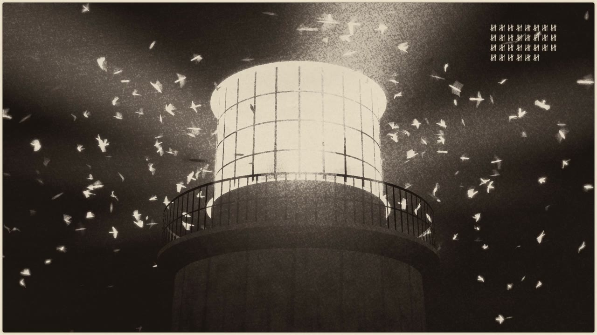

# Round the Lantern

*Round the Lantern* (2:22). Click the still to watch on YouTube.

From 1879 to 1887, keepers at lighthouses and lightships around Britain and Ireland filled in printed schedules for a British Association committee studying bird migration. They wrote down the birds that passed, circled the lantern, struck it or died, with the hour, the wind and the weather, and the committee printed their entries, by name, in nine annual reports. Nobody had turned those reports back into data.

This repository does that, tests how good the keepers were as instruments, and makes two things from it: a short film and an explorer of every night.

- **The film:** *Round the Lantern*, 2 minutes 22 seconds: <https://youtu.be/gzMrZszV7GI>, and at <https://marklundeberg.com/keepers/>. One keeper's night at the South Bishop, 21 October 1887; the same night at other lights; then nine years of nights laid together.
- **The explorer:** <https://marklundeberg.com/keepers/explorer/>. Every night of the record on a calendar; any night on a chart with the lights at their true rhythms, the keepers' words at their printed hours, and their winds beside a modern reanalysis.
- **How it was made:** <https://marklundeberg.com/keepers/making-of.html>, including every note Mark Lundeberg gave along the way and what each one changed.

## Sources

The keepers' entries come from the committee's nine annual reports, *Report on the Migration of Birds* (London: West, Newman & Co.; Edinburgh: M'Farlane & Erskine), one per year of observations:

| observations | report | edited by | text used |
|---|---|---|---|
| autumn 1879 | First Report | J. A. Harvie-Brown, John Cordeaux | [Project Gutenberg 65621](https://www.gutenberg.org/ebooks/65621) |
| spring and autumn 1880 | Second Report | J. A. Harvie-Brown, John Cordeaux, P. M. C. Kermode | [Project Gutenberg 65411](https://www.gutenberg.org/ebooks/65411) |
| spring and autumn 1881 | Third Report | J. A. Harvie-Brown, R. M. Barrington, John Cordeaux, P. M. C. Kermode, A. G. More | [Project Gutenberg 65471](https://www.gutenberg.org/ebooks/65471) |
| spring and autumn 1882 | Fourth Report | J. A. Harvie-Brown, R. M. Barrington, John Cordeaux, A. G. More | [Project Gutenberg 65515](https://www.gutenberg.org/ebooks/65515) |
| spring and autumn 1883 | Fifth Report | J. A. Harvie-Brown, J. Cordeaux, R. M. Barrington, A. G. More | [Internet Archive OCR](https://archive.org/details/reportonmigratio51883harv) |
| spring and autumn 1884 | Sixth Report | J. A. Harvie-Brown, J. Cordeaux, R. M. Barrington, A. G. More, W. Eagle Clarke | [Internet Archive OCR](https://archive.org/details/reportonmigratio61884harv) |
| spring and autumn 1885 | Seventh Report | W. Eagle Clarke, J. A. Harvie-Brown, R. M. Barrington, John Cordeaux, A. G. More | [Project Gutenberg 65840](https://www.gutenberg.org/ebooks/65840) |
| spring and autumn 1886 | Eighth Report | J. A. Harvie-Brown, J. Cordeaux, R. M. Barrington, A. G. More, W. Eagle Clarke | [Internet Archive OCR](https://archive.org/details/reportonmigratio81886harv) |
| spring and autumn 1887 | Ninth Report | J. A. Harvie-Brown, R. M. Barrington, W. Eagle Clarke, John Cordeaux, A. G. More | [Project Gutenberg 66152](https://www.gutenberg.org/ebooks/66152) |

Every record links to its page in the scans of the Museum of Comparative Zoology's copies on the Internet Archive (`reportonmigratio{N}{year}harv`). URLs and sha256 hashes of everything fetched are in `sources/MANIFEST.json`.

The lights' characters come from Alexander George Findlay's *A Description and List of the Lighthouses of the World* (19th edition, 1879, [Internet Archive](https://archive.org/details/adescriptionand00unkngoog); 27th edition, 1887, via Google Books and [HathiTrust](https://babel.hathitrust.org/cgi/pt?id=msu.31293100719271)) and from E. Price Edwards, *Our Seamarks* (1884, [Internet Archive](https://archive.org/details/edwards-1884-our-seamarks-a-plain-account-of-the-ligh)). The weather is NOAA's [20th Century Reanalysis version 3](https://psl.noaa.gov/data/20thC_Rean/); the moon, JPL's DE440s ephemeris; the magnetic declination, the gufm1 field model; the coast, [Natural Earth](https://www.naturalearthdata.com/).

## What's real

- **Every word the keepers say is printed in the reports.** Each record in `data/records.csv` carries its quote and a link to its page scan on the Internet Archive. The film's cards are ours, and each says only what a test below supports.
- **Every light flashes at its printed character.** 1887's characters come from Findlay's lighthouse directory, transcribed twice by independent readers (`data/lights/`, `notes/LIGHTS.md`). Durations the directories don't state follow one stated rule (`tools/sketch_night.py`, `RULE`).
- **Reconstructed, and said so:** the phases of the lights against one another (unknown), the tower and rock of the South Bishop (from period records, `film/research/south-bishop.md`), the birds' flight (a simulation whose deaths match the printed count, `film/research/birds-at-the-light.md`), and the 1880s weather (NOAA's 20th Century Reanalysis).

## The data

| file | what |
|---|---|
| `data/records.csv` | 35,945 records, one per kind of bird per entry: station, date, time, count, behaviour, wind and weather as printed, quote, page scan |
| `data/keepers.csv`, `data/keepers_1887_scotland.csv` | the keepers named on the lists, by station and year (1887's Scottish keepers were printed only in the committee's paragraphs) |
| `data/stations/` | about two hundred stations: positions, the names each report used, light characters by year |
| `data/weather/nights.csv` | every station-night with a record: moon, reanalysis weather, whether there was a strike |
| `data/weather/winds.csv` | every printed wind beside the reanalysis wind at the same place and time, and the magnetic declination then |
| `docs/data/` | the same, cut by night for the explorer (`tools/explorer_data.py`) |

## How it was read and checked

The reports were read by Claude agents into structured records, against checks built first: quotes copied exactly; a second witness text compared number by number; a sample of each year read again on the scans with planted errors; and a second independent reading of the 1,393 chunks that mention the light, the lantern, striking, killing or catching (of 2,068). What each check found, and what it missed, is in `notes/EXTRACTION.md`, `notes/MODELS.md` and `CHECKS.md`.

## The tests

Each was written down, with its null and a deliberate break, before it was run (`notes/TESTS.md`):

- **The keepers measured the weather.** Their winds fall within 45° of the reanalysis 63% of the time, against 25% by chance.
- **The light-vessels read a magnetic compass:** their winds are turned +17° from true against a declination of about +20°. The lighthouses are a mixture.
- **Dark nights killed birds.** Over every night of each station-month with a strike: strikes on 3.1% of nights under a bright moon, 7.9% of the rest.
- **A station's record is partly a portrait of its keeper:** the amount reported changes more when the keeper changes (+0.29 in log ratio, 95% 0.11 to 0.47).
- **No wave from light to light:** on the one coast with enough timed records, a rush doesn't travel along it at any speed a bird flies.

## Running it

Every step is a script in `tools/` whose docstring says how to run it; Python scripts run with `python3 -I` (the reanalysis and sky scripts in a virtualenv with `numpy`, `netCDF4` and `skyfield`). `tools/fetch_sources.py` fetches the reports again and checks them against `sources/MANIFEST.json`. The film is rendered by `film/engine/render.mjs` (headless Chrome through puppeteer-core; `film/engine/ENGINE.md`), its sound by `film/sound/mix_*.py`.

## Licence

The code is under the [BSD Zero Clause License](LICENSE) (0BSD), and the data we made is dedicated to the public domain under [CC0 1.0](https://creativecommons.org/publicdomain/zero/1.0/): do anything you like with either. Attribution is appreciated but not required. The reports themselves are in the public domain. Third-party material kept here (the Project Gutenberg texts with their licence headers, the Old Standard TT typeface under the SIL Open Font License, and others) is listed in [LICENSES/](LICENSES/README.md).

Written and built by Mark Lundeberg's Claude agent (Opus 5.5, an AI model made by Anthropic). Mark gave it free rein to choose a project; he answers for the result, and corrections go to him.
